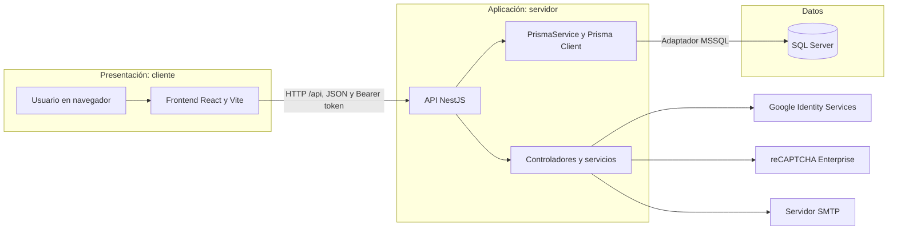

# Arquitectura y seguridad de AgendaVital

**Estado del documento:** describe el código revisado el 13 de noviembre de 2026. Distingue los controles implementados de los pendientes; no representa una certificación de seguridad ni sustituye pruebas de despliegue.

## 1. Propósito y alcance

AgendaVital es una aplicación web para gestionar procesos de salud ocupacional. El repositorio contiene un frontend React/Vite, una API NestJS, acceso a SQL Server mediante Prisma y una configuración de ejecución con Docker Compose.

La autenticación y la recuperación de contraseña están implementadas en la API. Las vistas de los módulos de negocio no deben asumirse conectadas a la base de datos solo por existir en el frontend; algunas funcionalidades continúan usando datos de demostración.

## 2. Arquitectura actual

El sistema corresponde al modelo **cliente-servidor organizado en tres capas lógicas**:

| Capa | Parte de AgendaVital | Responsabilidad |
|---|---|---|
| Presentación (cliente) | React/Vite en el navegador; los archivos de producción se sirven con Nginx en Docker. | Mostrar la interfaz y enviar solicitudes HTTP/JSON a la API. |
| Aplicación y lógica de negocio (servidor) | API NestJS, organizada en controladores y servicios. | Recibir solicitudes `/api`, aplicar autenticación/autorización y ejecutar las operaciones de la aplicación. |
| Datos | SQL Server, accedido desde NestJS mediante Prisma Client y el adaptador MSSQL. | Guardar y consultar la información persistente. |

Prisma no constituye una cuarta capa ni es un servidor independiente: es la herramienta de acceso a datos que utiliza el backend para comunicarse con SQL Server. La separación de tres capas describe las responsabilidades y el recorrido de las solicitudes; no significa que ya exista una capa Repository independiente en el código. Actualmente, servicios como `AuthService` usan `PrismaService` directamente.

En Docker Compose, estas responsabilidades se despliegan principalmente como tres servicios: `frontend`, `backend` y `database`. El servicio puntual `database-init` prepara el esquema y los datos iniciales; no es una capa adicional de la aplicación.

### Componentes principales

| Componente | Responsabilidad | Código de referencia |
|---|---|---|
| Frontend | Formularios de acceso y recuperación, navegación, estado de sesión y llamadas HTTP. | `frontend/src/pages/`, `frontend/src/services/`, `frontend/src/features/auth/` |
| API | Prefijo `/api`, configuración de CORS y módulos de aplicación. | `backend/src/main.ts`, `backend/src/app.module.ts` |
| Autenticación | Login local y Google, reCAPTCHA, recuperación de contraseña y creación de JWT. | `backend/src/auth/auth.controller.ts`, `backend/src/auth/auth.service.ts` |
| Persistencia | Prisma conecta la API a SQL Server usando el adaptador MSSQL y las variables `DB_*`. | `backend/src/database/prisma/`, `backend/prisma/schema.prisma` |
| Ejecución Docker | SQL Server, inicialización/seed, API y frontend servido por Nginx. | `compose.yaml`, `backend/Dockerfile`, `frontend/Dockerfile` |

El backend está separado actualmente en los módulos de autenticación y persistencia. No se debe presentar como terminada una API de negocio para cada módulo del panel sin verificar sus endpoints y conexión real.

## 3. Endpoints de autenticación

Todos los endpoints están bajo `/api`:

| Método y ruta | Uso | Control observado |
|---|---|---|
| `POST /api/auth/login` | Acceso con correo y contraseña. | Máximo 5 solicitudes por minuto; exige validación reCAPTCHA. |
| `POST /api/auth/google` | Acceso con credencial de Google. | Máximo 5 solicitudes por minuto. |
| `POST /api/auth/forgot-password` | Solicitar enlace de recuperación. | Máximo 3 solicitudes cada 15 minutos. |
| `POST /api/auth/reset-password` | Cambiar contraseña con token. | Máximo 5 solicitudes cada 15 minutos. |

Los límites están configurados con `@nestjs/throttler`. Su almacenamiento es local al proceso por defecto; en despliegues con varias instancias se necesitaría almacenamiento compartido para que el límite sea común.

## 4. Flujos de autenticación

### Correo y contraseña

1. El frontend obtiene un token de reCAPTCHA y lo envía junto al correo y la contraseña.
2. La API valida el token contra reCAPTCHA Enterprise y compara el hostname con la lista permitida.
3. La API busca una cuenta activa y compara la contraseña con el hash almacenado mediante `bcryptjs`.
4. Si la cuenta tiene un rol reconocido, se genera un JWT firmado con HS256 y duración de una hora.
5. El frontend guarda la sesión en `sessionStorage` y envía el JWT como `Authorization: Bearer ...` en las solicitudes posteriores.

### Google

1. Google Identity Services entrega una credencial al frontend.
2. La API verifica la firma y audiencia con `GOOGLE_CLIENT_ID`.
3. La API exige que el correo de Google esté verificado y corresponda a una cuenta existente y activa de AgendaVital.
4. La API crea la misma sesión JWT que usa el acceso local.

El flujo no crea usuarios ni roles automáticamente. El reCAPTCHA está conectado al login con correo y contraseña; el código revisado no lo aplica a Google ni a recuperación/restablecimiento.

### Recuperación de contraseña

1. La API responde con un mensaje genérico para no revelar si un correo está registrado.
2. Para una cuenta activa, genera un token aleatorio, almacena su hash SHA-256 y envía un enlace por SMTP.
3. El token vence en 15 minutos y los anteriores pendientes del usuario se marcan como usados.
4. Al restablecer, la API verifica vigencia y uso, actualiza la contraseña con bcrypt y marca el token como usado dentro de una transacción.

Si el envío SMTP falla, la API registra información técnica limitada en la consola, invalida el token generado y conserva una respuesta genérica para el usuario.

## 5. Controles implementados

- Verificación de JWT Bearer en `JwtAuthGuard`: valida formato, firma HMAC en tiempo constante, algoritmo, campos requeridos, rol, fechas y expiración.
- Autorización por rol en `RolesGuard`; el endpoint de diagnóstico `GET /api/prueba-db` exige el rol `ADMIN`.
- Hash de contraseñas con `bcryptjs`; el restablecimiento usa un costo de 12.
- Límites de solicitudes distintos para login, Google, solicitud de recuperación y cambio de contraseña.
- reCAPTCHA Enterprise validado desde el backend, incluyendo validez del token y hostname permitido.
- Recuperación con token aleatorio, hash guardado en base de datos, caducidad y uso único.
- CORS restringido a los orígenes indicados en `FRONTEND_URL`.
- Credenciales leídas desde variables de entorno; los archivos de ejemplo deben contener únicamente valores ficticios.

## 6. Pendientes y límites conocidos

Estos puntos no deben describirse como funciones ya completadas:

- **Cookies seguras:** actualmente el JWT queda en `sessionStorage`; no se usa cookie `HttpOnly`, `Secure` o `SameSite`. Una migración requiere decidir también protección CSRF y cambios coordinados en frontend y backend.
- **Renovación de sesión:** el JWT dura una hora y no se encontró un flujo de refresh token.
- **Cabeceras HTTP:** no se encontró configuración de Helmet en el arranque revisado.
- **Validación de entrada:** no se encontró un `ValidationPipe` global; parte de la validación se hace manualmente en `AuthService`.
- **Límites distribuidos:** el throttler usa el almacenamiento predeterminado del proceso, no un contador compartido entre réplicas.
- **API de negocio:** verificar cada módulo antes de afirmar que sus operaciones persisten en SQL Server; las pantallas frontend pueden conservar datos simulados.
- **Configuración Docker de servicios externos:** `compose.yaml` no pasa actualmente al backend las variables de reCAPTCHA ni las de SMTP. El build del frontend tampoco recibe `VITE_GOOGLE_CLIENT_ID` ni `VITE_RECAPTCHA_SITE_KEY`. Por tanto, no debe asumirse que esos flujos están configurados en Docker aunque funcionen localmente.
- **Nombres SMTP:** `AuthService` busca variables `SMIP_HOST`, `SMIP_PORT`, `SMIP_USER`, `SMIP_PASS`, `SMIP_FROM` y `SMIP_SECURE`. El prefijo aparece escrito `SMIP`; debe confirmarse antes de documentar un ejemplo de configuración definitivo.
- **Ejemplos de entorno:** los archivos `.env.example` contienen nombres y marcadores ficticios, no credenciales listas para usar. Cada entorno debe configurar sus valores privados localmente.

## 7. Variables de entorno

Los nombres se listan para orientar la configuración; no se escriben aquí valores reales.

| Variable | Uso | Dónde se consume |
|---|---|---|
| `DB_SERVER`, `DB_PORT`, `DB_DATABASE`, `DB_USER`, `DB_PASSWORD` | Conexión de Prisma a SQL Server. | `backend/src/database/prisma/prisma.service.ts` |
| `JWT_SECRET` | Firma y validación de JWT. | `backend/src/auth/auth.service.ts`, `backend/src/auth/JwtAuthGuard.ts` |
| `FRONTEND_URL` | Orígenes CORS y enlace del correo de recuperación. | `backend/src/main.ts`, `backend/src/auth/auth.service.ts` |
| `GOOGLE_CLIENT_ID` | Audiencia esperada de credenciales Google. | `backend/src/auth/auth.service.ts` |
| `RECAPTCHA_PROJECT_ID`, `RECAPTCHA_SITE_KEY`, `RECAPTCHA_API_KEY`, `RECAPTCHA_ALLOWED_HOSTNAMES` | Validación de reCAPTCHA Enterprise. | `backend/src/auth/auth.service.ts` |
| `VITE_RECAPTCHA_SITE_KEY` | Renderizado del checkbox en el frontend. | `frontend/src/components/forms/RecatchaCheckbox.jsx` |
| `VITE_GOOGLE_CLIENT_ID` | Inicialización de Google Identity Services. | `frontend/src/pages/LoginPage.jsx` |
| `VITE_API_BASE_URL` | Dirección base de la API. | `frontend/src/services/apiClient.js` |
| `SMIP_HOST`, `SMIP_PORT`, `SMIP_USER`, `SMIP_PASS`, `SMIP_FROM`, `SMIP_SECURE` | Envío de correo de recuperación según los nombres que espera hoy el servicio. | `backend/src/auth/auth.service.ts` |

La configuración de Docker debe revisarse por separado: las variables del backend local no se transmiten automáticamente a los contenedores.

## 8. Evidencia y verificación

La documentación se contrastó con los archivos de referencia indicados en cada sección. En esta actualización no se ejecutaron build, pruebas automatizadas ni pruebas de despliegue; por tanto, este documento describe el código observado, no certifica una ejecución reciente.

Para una entrega verificable, adjuntar evidencia separada de:

1. Respuesta `401` al solicitar una ruta protegida sin JWT y respuesta permitida con un token válido del rol autorizado.
2. Respuestas `429` al superar los límites de autenticación configurados.
3. Token reCAPTCHA aceptado/rechazado por el backend y hostname configurado.
4. Correo de recuperación recibido, enlace vencido/reutilizado rechazado y contraseña nueva aceptada en login.
5. Inicio de los servicios y conexión real a SQL Server en el modo de ejecución que se presente.

No incluir en capturas o documentación contraseñas, tokens, secretos JWT, claves API, secretos OAuth ni archivos `.env` reales.
